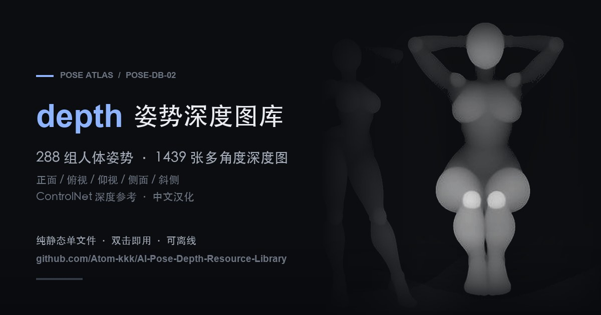

# AI 姿势深度图库 · 中文汉化版

[](https://atom-kkk.github.io/AI-Pose-Depth-Resource-Library/)




> 288 组人体姿势、1439 张多角度 **depth 深度图**的纯静态画廊：零依赖、零构建，可本地离线运行，支持按体系、分类、视角筛选与一键下载原图。

**在线体验：** https://atom-kkk.github.io/AI-Pose-Depth-Resource-Library/ · **姊妹项目（线稿分册）：** [AI-Pose-Resource-Library](https://github.com/Atom-kkk/AI-Pose-Resource-Library) · **原始图库：** [ai-pose-depth-gallery.pages.dev](https://ai-pose-depth-gallery.pages.dev/)（POSE-DB-02） · **原作者：** ギア

---

## 这是什么

原始图库是一套面向 AI 绘画的人体姿势**深度参考图**（无五官的灰色素体 depth map，白色越靠前），元数据为日文，单页静态 HTML。本项目在它的基础上做成一个**可以长期自己用下去**的工具：

1. **素材完全本地化** —— 1439 张缩略图全部落地到 `thumbs/`，断网、无 CDN 也能正常浏览。
2. **中文汉化** —— 体系、分类、姿势名称、角度全部译为中文，搜索与筛选更顺手。
3. **多维度筛选** —— 按体系（全身单人·标准系 / 性感系 / 上半身 / 双人）、动作分类（站姿 / 坐姿 / 躺卧等 26 类）、视角（正面 / 俯视 / 仰视 / 侧面 / 斜侧）交叉筛选。
4. **多角度对比** —— 同一姿势支持 5 个视角切换，便于保持生成图中的姿态一致。
5. **零门槛运行** —— 只有一个 `index.html`（数据内联），双击就能用；也能扔到任意静态托管上。

## 和姊妹项目的区别

两个仓库出自同一原站、同一套姿势编号，但图像内容与用途不同：

| | 本项目（depth 分册） | [AI-Pose-Resource-Library](https://github.com/Atom-kkk/AI-Pose-Resource-Library)（线稿分册） |
|---|---|---|
| 图像内容 | **深度图**（depth map，白=近） | 灰度素体线稿 |
| 主要用途 | ControlNet / depth 参考，锁定**空间姿态与前后关系** | 构图、人体结构、姿势线稿参考 |
| 适合场景 | 图生图、姿态控制、视频动作一致性 | 草图、构图推敲、人体练习 |
| 数据规模 | 1439 张 / 288 组 | 1439 张 / 288 组 |

> 同一姿势在两个仓库里用**相同的 `id` 与 `姿势编号`**，可以混用：线稿定构图、深度图定空间。

## 数据规模

| 体系 | 张数 | 姿势组 |
|---|---|---|
| 上半身单人 | 400 | 80 |
| 全身单人·性感系 | 399 | 80 |
| 全身单人·标准系 | 365 | 73 |
| 双人互动 | 275 | 55 |
| **合计** | **1439** | **288** |

- **姿势编号：** 80 个（P001–P080），多视角展开为 288 组
- **视角分布：** 正面 288 · 俯视 288 · 侧面 288 · 斜侧 288 · 仰视 287
- **图片尺寸：** 900 × 1200 原图 PNG（灰度，单张约 100 KB），缩略图 JPG

## 功能

### 浏览

- 按体系、分类、视角交叉筛选，计数按实际条目实时统计
- 关键词搜索（姿势名称、编号、ID、分类）
- 按姿势分组 / 逐张浏览两种视图切换
- 卡片悬停切换角度预览，点击进入大图灯箱
- `← / →` 切换角度，`↑ / ↓` 切换姿势，`Esc` 关闭；手机可左右滑动

### 下载

- 大图灯箱内可下载 900 × 1200 原尺寸 PNG，**线上与本地都能下**
- 页面内置「使用提示」与「注意事项」两个说明面板（原站内容全量汉化）

## 目录结构

```
.
├── index.html            # 样式 / 逻辑 / 1439 条数据全部内联（构建产物）
├── data/
│   └── pose-depth-zh.json  # 原始结构化数据（中文汉化）
├── img/                  # 原图 900×1200 PNG，1439 张，约 144 MB
├── thumbs/               # 缩略图 JPG，1439 张，约 12 MB
├── assets/og.jpg         # 分享卡（Open Graph / 社交预览）
├── site_raw.html         # 原站原始 HTML（构建输入，保留日文原文以便复现）
├── build_depth.py        # 复刻脚本：汉化 + 数据内联 + 移除埋点
├── i18n.py               # 日→中 翻译词典（288 条姿势名 + 30 条体系/分类）
├── fetch_assets.py       # 图片下载脚本：并发 + 断点续传
├── tools/make_og.py      # 分享卡生成脚本
├── NOTICE-IMAGES.md      # 图片权利与来源说明
├── LICENSE               # 代码：MIT
└── README.md
```

## 数据结构

内置数据是 `data/pose-depth-zh.json` 里的一个数组，字段与姊妹项目保持一致：

```json
[{
  "id": "full_sexy_P001_front",
  "体系": "全身单人・性感系",
  "姿势编号": "P001",
  "分类": "站姿",
  "姿势名称": "S形站姿・腰部向侧面挺出",
  "角度": "正面",
  "缩略图": "thumbs/full_sexy_P001_front.jpg",
  "原图": "img/full_sexy_P001_front.png",
  "检索": "full_sexy_P001_front 全身单人・性感系站姿S形站姿・腰部向侧面挺出正面"
}]
```

`id` 命名规则为 `{体系}_{姿势编号}_{角度}`，角度后缀为 `front / high / low / side / diag`。

## 本地使用

**方式一：直接双击**

打开 `index.html` 即可，无需服务器、无需联网。

**方式二：本地静态服务器（推荐）**

```bash
cd AI-Pose-Depth-Resource-Library
python3 -m http.server 8080
# http://localhost:8080
```

## 重新构建

`index.html` 是 `site_raw.html` + `i18n.py` 的产物，改完词典重跑即可：

```bash
python3 build_depth.py
```

脚本做四件事：把数据数组转成中文（含 `检索` 字段）、汉化界面文案与说明面板、移除 Cloudflare 统计埋点、收紧 CSP 为仅本地图片。其余字节与原站保持一致。

## 部署

纯静态文件，扔哪都能跑：

| 平台 | 做法 |
|---|---|
| GitHub Pages | Settings → Pages → 分支 `main` / 根目录 |
| Cloudflare Pages / Vercel / Netlify | 构建命令留空，输出目录 `/` |
| 任意静态托管 | 上传全部文件，入口 `index.html` |
| 内网 / NAS | 放进 Web 目录即可 |

## 原图（PNG）说明

1439 张 900×1200 灰度原图（`img/`，约 144 MB）与缩略图一起提交在仓库里，因此**线上站点点开灯箱即可直接下载原尺寸 PNG**，不用回原站取图；克隆下来后本地也完整可用。

单张仅约 100 KB（PNG 灰度、无压缩损失），画质与原站逐字节一致。全站体积约 157 MB，仍在 GitHub Pages 的 1 GB 发布上限内。

如需重新镜像或校验，运行随附的下载脚本（16 并发 + 断点续传，已存在且 >1 KB 的文件自动跳过）：

```bash
python3 fetch_assets.py --all      # 缩略图 + 原图
python3 fetch_assets.py            # 只补缩略图
python3 fetch_assets.py --check    # 只检查本地完整性
```

## 内容提示

图库为 AI 生成的**虚构人体姿势深度图**，无五官、无服装、非真实人物，本质是表达空间前后关系的灰度图。素材仅供艺术创作、姿态控制与构图参考使用，请勿用于违法用途，也请勿用于表现真实人物或未成年人。

## 版权与致谢

- **图片与原始数据的著作权归原作者 ギア 所有**，来源为 POSE Atlas depth 分册（[ai-pose-depth-gallery.pages.dev](https://ai-pose-depth-gallery.pages.dev/)）。
- 原站说明：图片可免费用于创作（含商业作品的制作、编辑、参考），但**禁止再分发、转载或转售图片数据本身**。本仓库对图片**不主张任何权利**，也不构成对原作品的商业授权；如需商用请自行联系原作者。
- 本仓库仅作个人学习、素材存档与前端工程实践；若原作者认为有不妥，请联系删除。
- **代码**（`index.html` 中的样式、脚本、交互逻辑，`build_depth.py`、`fetch_assets.py`、`i18n.py`，以及 `data/pose-depth-zh.json` 的汉化整理）以 **MIT** 授权，见 [LICENSE](LICENSE)；该协议**不覆盖** `thumbs/`、`img/` 里的图片，详见 [NOTICE-IMAGES.md](NOTICE-IMAGES.md)。
